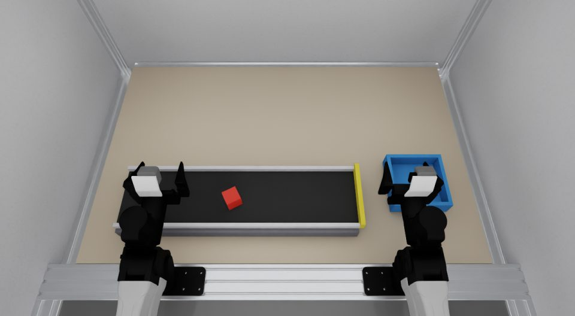

# YAM Conveyor × Long-WAM

**Project page:** https://kabilankb.github.io/yam-conveyor-longwam/ ·
**PDF:** [docs/yam-conveyor-longwam.pdf](docs/yam-conveyor-longwam.pdf) ·
**Data:** [yam_conveyor_cube_rand](https://huggingface.co/datasets/kabilanKB/yam_conveyor_cube_rand),
[Long-WAM copy](https://huggingface.co/datasets/kabilanKB/yam_conveyor_cube_rand_longwam)



End-to-end workflow for teaching a **YAM bimanual robot** to pick a cube off a **moving conveyor**
with **Long-WAM** (NVlabs world-action model):

```
 sim/        YAMLab (Isaac Sim 6 / Isaac Lab 3): conveyor task + scripted expert  ──► LeRobot dataset
 training/   convert dataset ──► fine-tune Long-WAM-YAM on a cloud GPU box (Brev)  ──► checkpoint
 eval/       Long-WAM policy server on a Jetson AGX Thor  ◄── TCP ──►  YAMLab eval client (workstation)
 video/      LongLive2.0-Robot "imagination" video of the scene on the Thor
```

Machine addresses are never hard-coded: pass them as arguments or environment variables
(`USER@THOR_HOST`, `LONGWAM_SERVER=HOST:PORT`, Brev instance name).

| Folder | Contents |
| --- | --- |
| `sim/yamlab/` | `ConveyorCubePick-v0` task (scene, conveyor drive, success checks, YAML config) |
| `sim/scripts/` | `generate_conveyor_data.py` (scripted IK expert + recorder), `probe_conveyor.py` |
| `sim/assets/hdris/` | 10 HDRI environment maps for lighting randomization (8 train / 2 eval) |
| `sim/install_into_yamlab.sh` | installs the task, scripts and HDRIs into a YAMLab checkout |
| `training/` | dataset converter + loader check, Brev setup, `train.sh smoke/action/full`, Long-WAM patches |
| `eval/thor/` | `setup_thor.sh`, `serve_yam.sh`, policy server (`longwam_yam_server.py`), wire protocol, mock server |
| `eval/client/` | `eval_longwam_remote.py` closed-loop YAMLab evaluation against the server |
| `video/` | `run_on_thor.sh`, Stage-1 SDPA patch, a 1280×704 start frame of the scene |
| `docs/` | GitHub Pages site (pipeline diagram, status, reference images) and its PDF |

## 1. Simulation and data (workstation with an RTX GPU)

Requirements: a YAMLab checkout ported to Isaac Sim 6.0.1 / Isaac Lab 3 and its conda env
(Isaac Sim + Isaac Lab + YAMLab's LeRobot fork).

```bash
bash sim/install_into_yamlab.sh /path/to/yamlab6
cd /path/to/yamlab6
python scripts/conveyor/probe_conveyor.py --headless --enable_cameras        # renders, checks the belt
python scripts/conveyor/generate_conveyor_data.py --num_episodes 5 --no_record \
    --debug_dir /tmp/conv_dbg --headless --enable_cameras                      # dry run with debug videos
python scripts/conveyor/generate_conveyor_data.py --num_episodes 200 --max_attempts 400 \
    --output datasets/yam_conveyor_cube_rand --hdris_path assets/hdris --seed 200 \
    --headless --enable_cameras                                                 # GUI: --viz kit
```

**Task.** A 4 cm red cube rides a conveyor (along −Y, in front of both arms). The right arm intercepts
it, lifts it and drops it into a blue bin; the left arm stays home. Success = cube lifted off the belt,
then resting in the bin with the gripper open. All scene objects are primitives (no `--asset` folders).

**Conveyor model.** The belt is a static low-friction collider. Each control step the env sets the cube's
velocity to `env.conveyor_speed` while it lies on the belt and no gripper holds it (≈85 % of the
commanded speed arrives, because of friction between control steps).

**Randomization per episode.**
- Belt speed: 4–7 cm/s.
- Cube spawn: ±1.5 / ±4 cm and ±45° yaw.
- Bin position: ±5 cm (x) / ±6 cm (y). The bin is five kinematic boxes moved together.
- Lighting (with `--hdris_path`): dome intensity 300–1200, colour temperature 2000–8000 K, random HDRI.
- Expert motion: pick point, heights and timings.

**Expert.**
1. Ready: smooth joint move home → ready pose.
2. Hover above the pick point.
3. Track the moving cube while descending, with DLS IK on a fingertip tool point.
4. Close the gripper.
5. Lift.
6. Carry: joint-space move to a calibrated pose above the bin.
7. Lower.
8. Release.
9. Retreat.

Ready and bin poses are solved once per run in an unrecorded calibration pass. Only successful
attempts are recorded; `meta/generation_log.json` lists every attempt.

**Output.** LeRobot v2.0, 30 Hz, 14-D state/action, `top_rgb` / `left_rgb` / `right_rgb` at 320×240.
Measured: 87 % expert success, ~35 s per attempt on an RTX laptop GPU, episodes of 274–564 steps.
Published runs: `kabilanKB/yam_conveyor_cube_rand` (200 episodes) and its Long-WAM copy below.

## 2. Convert for Long-WAM

```bash
python training/convert_yamlab_to_longwam.py datasets/yam_conveyor_cube_rand data/yam_conveyor/dataset
```
- Cameras are renamed to the YAM checkpoint's names: `top` / `left_wrist` / `right_wrist`.
- The gripper is mapped from finger metres (−0.0475 open … 0 closed) to the checkpoint's 0..1 convention, where 1 = open.
- Videos are hard-linked, not re-encoded.

Already published as `kabilanKB/yam_conveyor_cube_rand_longwam`.

Optional CPU check through Long-WAM's real data loader. It needs Long-WAM + CPU torch 2.7 and
**PyAV 14.2**, because PyAV ≥ 15 breaks torchvision 0.22's video reader:
```bash
LONGWAM_DATA_ROOT=$PWD/data LONGWAM_CHECKPOINT_ROOT=/path/to/checkpoints \
  python training/check_dataset.py --dummy_text --out sample.png   # run from a scratch dir
```

## 3. Training on Brev (cloud GPU)

The recipe (`training/longwam_patches/configs/{data,task}/yam_conveyor.yaml`) follows the
**Long-WAM-YAM checkpoint**, not RoboTwin. The resolved model config matches the checkpoint's
`config.yaml` key for key:
- Per-camera 224×224, tiled into the robotwin 384×320 mosaic.
- 81 frames with 21 sampled (`decode_only_sampled_video_frames: true`), P48 history, 32-step chunks.
- Normalization with the checkpoint's own `dataset_stats.json`.
- Starts from the full YAM policy (`resume=.../model.pt`).

`train_modules: action` (added by `train_modules.patch`) trains only the 1 B action expert and the
proprio adapter. The 5 B video expert is frozen; its cache is detached from the action loss anyway.

```bash
brev login                                                    # your API key / org
brev create longwam-yam-ft --type massedcompute_RTXPro6000x2   # 2x RTX PRO 6000 96 GB, ~$5/h, not stoppable
rsync -a ./ longwam-yam-ft:~/yam-conveyor-longwam/            # this package
rsync -aL data/yam_conveyor/ longwam-yam-ft:~/longwam/data/yam_conveyor/   # optional, else pulled from HF
ssh longwam-yam-ft
tmux new -s setup 'bash ~/yam-conveyor-longwam/training/brev_setup.sh 2>&1 | tee ~/setup.log'
tmux new -s train 'bash ~/yam-conveyor-longwam/training/train.sh smoke 2>&1 | tee ~/smoke.log'   # 30 steps
tmux new -s train 'bash ~/yam-conveyor-longwam/training/train.sh action'   # or: full (ZeRO-1, 2 GPUs)
```

`brev_setup.sh` does the following, and is safe to re-run:
1. Clones Long-WAM and applies the patches.
2. Installs torch 2.7.1+cu128 and Long-WAM `[train]`.
3. Downloads the YAM checkpoint, the Wan2.2 VAE and the UMT5 text encoder/tokenizer.
4. Pulls the dataset unless it is already there.
5. Encodes the instruction.

| Mode | Trainable | Defaults (override with `key=value`) |
| --- | --- | --- |
| `smoke` | action expert | 30 steps, no checkpoint: check memory + s/step first |
| `action` | action expert + proprio | lr 1e-4, 4 epochs, global batch 128 (2 GPUs × 8 × accum 8), save every 500 |
| `full` | video + action experts | lr 3e-5, same schedule, Accelerate ZeRO-1 |

Measured run (2 epochs, action expert): 5.21 h on `massedcompute_RTXPro6000x2` at $5.26/h = **$27.40**
(setup 0.4 h, training 3.3 h, checkpoint downloads 1.5 h). Upload checkpoints straight to Hugging Face from
the instance where possible: relaying 2 GB files through a home connection cost about $8 of idle GPU time.

Outputs go to `~/longwam/outputs/yam_conveyor/<timestamp>/`. With `train_modules: action` only the action
expert changes, so cut each 12 GB `checkpoints/weights/step_XXXXXX.pt` down to a ~2 GB action delta before moving it:
`python training/extract_action_delta.py step_000250.pt action_step_000250.pt --base <base>/model.pt`
(`--base` also verifies that the video expert is unchanged). Upload the weights you want to keep
(e.g. `hf upload`) and **delete the instance** when done (`brev delete longwam-yam-ft`): it bills until deleted.

## 4. Policy server on the Jetson Thor

```bash
rsync -a ./ USER@THOR_HOST:~/yam-conveyor-longwam/
ssh USER@THOR_HOST 'bash ~/yam-conveyor-longwam/eval/thor/setup_thor.sh'      # once (~30 GB downloads)
ssh USER@THOR_HOST 'bash ~/longwam/yam_bridge/serve_yam.sh --tmux'           # pretrained YAM checkpoint
# fine-tuned: merge an action delta into the base bundle, then serve that directory
ssh USER@THOR_HOST 'cd ~/longwam/LongLive/Long-WAM && ~/longwam/.venv/bin/python ~/longwam/yam_bridge/merge_action_delta.py \
    checkpoints/yam action_step_000250.pt ~/longwam/checkpoints/yam_conveyor_ft'
# (a merged directory holds model.pt + the checkpoint's config.yaml and dataset_stats.json)
ssh USER@THOR_HOST 'CKPT_DIR=~/longwam/checkpoints/yam_conveyor_ft bash ~/longwam/yam_bridge/serve_yam.sh --tmux'
```
`setup_thor.sh` has to work around three things:
- It installs torch 2.9.1 for CUDA 13 (sm_110), because Long-WAM's `<2.8` pin has no Thor build.
- It writes `config_infer.yaml`, because the released YAM `config.yaml` lacks `processor.train_transforms`.
- `serve_yam.sh` does the same for any checkpoint directory.

Measured cost per inference: ~60 s to load, then ~2.1 s per 32-step chunk (reference backend, 10 action
denoising steps).

**Protocol** (`eval/thor/wire.py`): length-prefixed JSON header + JPEG blobs, no pickle.
- `info`
- `reset(instruction)`
- `step(obs[...], infer)` → `actions[32][14]`

## 5. Closed-loop evaluation (workstation)

```bash
export LONGWAM_SERVER=THOR_HOST:8780
python scripts/eval/eval_longwam_remote.py --task ConveyorCubePick-v0 --num_episodes 10 \
    --timeout_steps 600 --hdris_path assets/hdris --enable_cameras --headless   # GUI: --viz kit
```
What the client does:
- Streams the three cameras + 14-D state every step.
- Executes 24 of each 32-step chunk, then replans.
- Converts the gripper units both ways.
- Writes `results.json`, per-episode `npz` trajectories and mosaic mp4s to `outputs/eval/longwam_yam/<ts>/`.

The sim waits for each chunk, so inference latency does not change the physics.
`eval/thor/mock_server.py` (hold-pose chunks) tests the client without a model.

Results so far (conveyor task, 10 episodes each):
- Pretrained Long-WAM-YAM: 0/10. Both arms move, grippers never close (also 0/5 on PutPotOnCooktop and PutAppleInBowl).
- Fine-tuned step 250: 0/10. The idle left arm now stays home and the right arm takes the expert's hover pose.
- Fine-tuned final (step 1,216): 0/10. The left arm stays still (0.07 rad) and the right arm follows the cube, but it does not dive and grasp.
- Checkpoints: https://huggingface.co/kabilanKB/longwam-yam-conveyor

## 6. Imagination video (LongLive2.0-Robot)

```bash
bash video/run_on_thor.sh USER@THOR_HOST                       # default: conveyor start frame + prompt
bash video/run_on_thor.sh USER@THOR_HOST my_1280x704.png "pick up the cup"
```
- Generates a 125-frame (5.2 s, 24 fps) video in about 9 minutes on the Thor, without FlashAttention (`stage1_sdpa_fallback.patch`).
- Zero-shot on the conveyor frame, the model keeps the scene consistent and makes an arm reach across and grasp the cube.
- It picks the arm on the image's left, not the prompted right gripper.

## Notes

- Long-WAM: https://github.com/NVlabs/LongLive/tree/main/Long-WAM (paper arXiv 2610.10528).
  Checkpoints: `Efficient-Large-Model/Long-WAM-YAM`, `Efficient-Large-Model/LongLive2.0-Robot-S`.
- PyAV: ≥ 15 breaks torchvision 0.22 `VideoReader`; 14.3/14.4 have no cp312 wheels; use 14.2.0.
  On JetPack, building PyAV from source fails, so keep the wheel already in the venv.
- Long-WAM writes `./runs/dataset_stats.json` relative to the working directory.
- Third-party code, assets and licenses: see [NOTICE.md](NOTICE.md).
